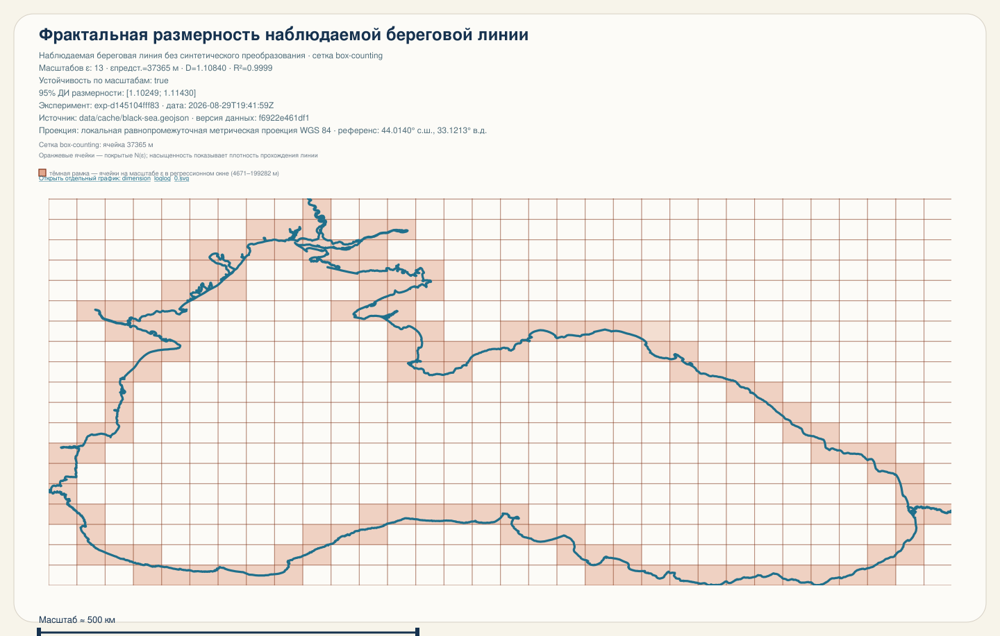
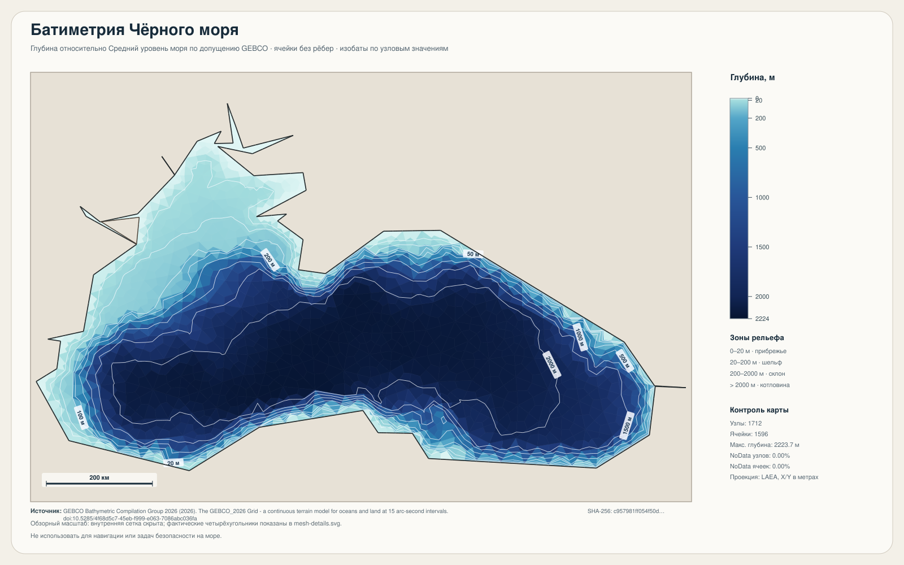
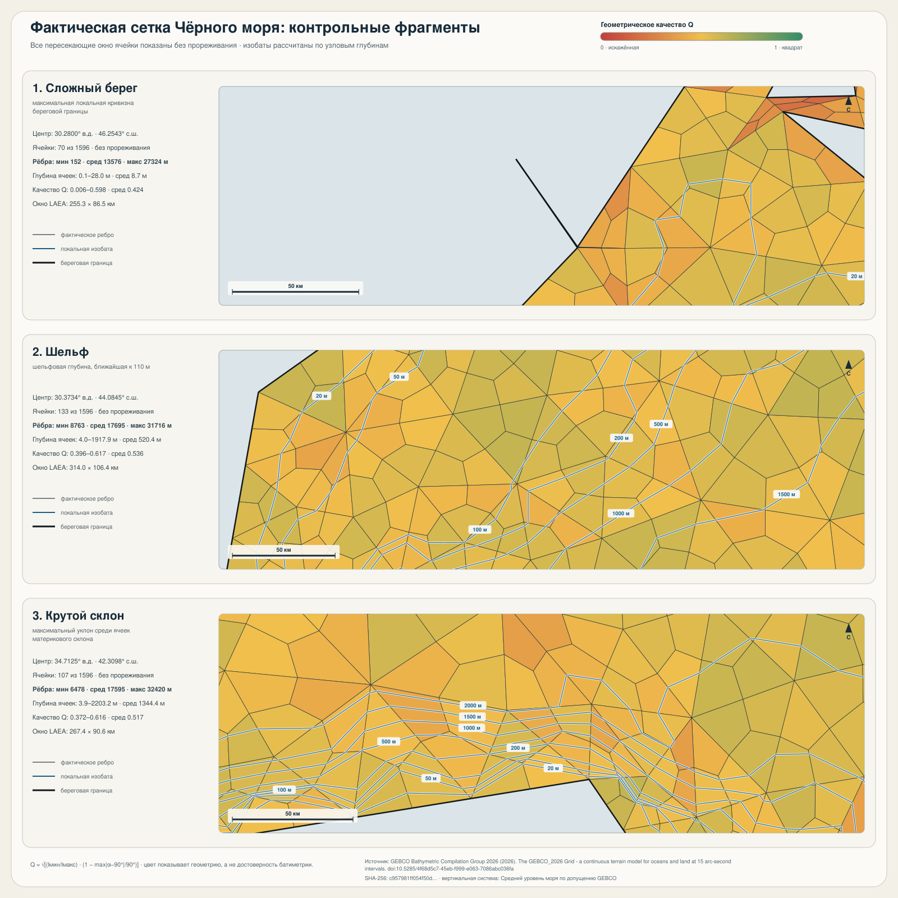

# Litora

**Исследовательская лаборатория прибрежных систем Чёрного моря**

[](apps/lito-cli/go.mod)
[](apps/lito-web/package.json)
[](sdd/development.md)
[](apps/lito-web/package.json)
[](apps/lito-api/package.json)
[](infra/compose.yaml)
[](package.json)
[](infra/compose.yaml)
[](LICENSE)

Litora помогает строить и исследовать **геометрические образы береговой линии и рельефа дна**, проверять исходные геоданные и проводить воспроизводимые вычислительные эксперименты. Предметная область проекта — Чёрное море: от выбора участка побережья и анализа масштаба контура до расчётных сеток, батиметрии и моделей прибрежных процессов.

У проекта два интерфейса к одному научному ядру на Go: **лаборатория в браузере** с личной историей заданий и **самостоятельная программа командной строки `lito`**. Сайт отправляет параметры в API; отдельный worker запускает Go-ядро и сохраняет результаты. CLI работает локально без аккаунта, API и облачного хранилища.

<p align="center">
  
  
</p>
<p align="center">
  
</p>

*Контур, карта глубин и фрагменты сетки — примеры результатов вычислительного ядра.*

## Что умеет Litora

| Направление | Возможности |
| --- | --- |
| **Береговая линия** | Проверка геометрии и происхождения GeoJSON, выбор участка Чёрного моря на карте, построение обзорных SVG и оценка фрактальной размерности методом box-counting. |
| **Сетки и рельеф дна** | Генерация и сравнение 2D-сеток Gmsh, назначение глубин, адаптивные сетки, карты батиметрии, изобаты, 3D-виды и профили; отчёты о качестве и сравнении моделей. |
| **Прибрежные процессы** | Демонстрационные и пользовательские расчёты переноса наносов по модели CERC, составной конвейер анализа, калибровка по наблюдениям и аудит временного ряда береговой линии. |
| **Воспроизводимость** | Параметры, версии и происхождение данных, контрольные суммы, SVG/JSON/GeoJSON/MSH и другие артефакты. В кабинете — статус, история, просмотр, сравнение и скачивание собственных результатов. |

В лаборатории доступны как встроенные примеры, так и сценарии со своими файлами. Расчёты сеток и рельефа дна требуют отдельного **heavy worker**; обычный запуск сайта их не включает. Точное соответствие команд CLI и сценариев сайта, ограничения входных данных и необходимые внешние инструменты описаны в [реестре возможностей](sdd/cli-capabilities.md) и [научном справочнике](packages/docs/content/).

Litora — исследовательский инструмент. Демонстрация эрозии не является прогнозом размыва, а качество результата зависит от исходных данных, масштаба и проверок метода. Ревизия реализации и манифест не означают научную аттестацию.

## Два режима работы

| | Лаборатория на сайте | Автономный CLI `lito` |
| --- | --- | --- |
| **Как начать** | Запустить платформу, получить одноразовый ключ приглашения и зарегистрироваться | Скачать готовую сборку в разделе «Скачать CLI» на сайте или собрать Go-программу |
| **Где выполняются расчёты** | В отдельном worker через то же Go-ядро | На вашем компьютере |
| **Данные и результаты** | Приватные файлы в S3-совместимом хранилище, метаданные и история в PostgreSQL | Локальные входные файлы и каталог `output/` либо путь из `--output` |
| **Для чего удобен** | Работа с собственными наборами, очередью заданий, отчётами и сохранённой историей | Скрипты, локальные эксперименты и полный набор команд без сервера |
| **Что требуется** | API, worker, PostgreSQL, S3 и аккаунт; heavy worker для ресурсоёмких сценариев | Бинарник `lito`; для отдельных команд — Gmsh и подготовленные научные данные |

## Быстрый запуск сайта

Понадобятся **Docker Desktop / Docker Compose**, **Git LFS**, **Node.js 22.12+** и **pnpm 10.15.0**. Локальный Go для этого режима не нужен: образ собирает ядро сам.

```bash
git clone https://github.com/Nickitas/litora.git
cd litora
git lfs install --local
git lfs pull
pnpm install --frozen-lockfile
pnpm up
```

`pnpm up` создаст отсутствующий `.env.local` со случайными локальными паролями, соберёт приложения и запустит PostgreSQL, MinIO, API, worker и web. Уже существующий `.env.local` не перезаписывается. Первый запуск может занять несколько минут. Если pnpm ещё не установлен: `npm install --global pnpm@10.15.0`.

| Что открыть | Адрес по умолчанию |
| --- | --- |
| Сайт | [localhost:5173](http://localhost:5173/) |
| Лаборатория | [localhost:5173/lab](http://localhost:5173/lab) |
| Вход и регистрация | [localhost:5173/login](http://localhost:5173/login) |
| Документация | [localhost:5173/docs](http://localhost:5173/docs) |
| Swagger API | [localhost:3000/api/docs](http://localhost:3000/api/docs) |

### Получить ключ приглашения и войти

Оператор выпускает ключ **после запуска API**. Для полного Docker-режима выполните из корня репозитория:

```bash
docker compose --env-file .env.local -f infra/compose.yaml -f infra/compose.local.yaml exec -T api node dist/scripts/invitations.js create --expires-hours 168
```

В ответе `invitations[0].code` находится одноразовый ключ; `id` нужен, если приглашение потребуется отозвать. Код показывается только при выпуске, по умолчанию действует семь дней и создаёт один аккаунт. Передавайте его получателю приватно, не сохраняйте в Git или общих логах.

На странице [входа](http://localhost:5173/login) выберите регистрацию, укажите имя, email, пароль не короче 10 символов и этот ключ. После входа откройте [лабораторию](http://localhost:5173/lab): начните с фрактальной размерности полного контура или обзорной карты. Для CERC выберите реальные сохранённые контур, волны и батиметрию своего участка. Существующему пользователю приглашение для входа не нужно.

Для сеток, батиметрии и других тяжёлых сценариев запустите профиль с Gmsh **вместо обычного** `pnpm up`:

```bash
pnpm down
pnpm up:heavy
```

Heavy-профиль рассчитан на 4 CPU и 12 ГБ RAM для одного задания. Состав входных файлов и ограничения описаны в [инструкции разработки](sdd/development.md#8-альтернатива-всё-в-docker). При смене режима сначала остановите прежний профиль.

Остановить локальную систему можно командой `pnpm down`. Пользователи и файлы останутся в Docker volumes; `down -v` удалит их.

## Быстрый запуск CLI

CLI нужен только **Go 1.25.4+** и исходный код с данными. Docker, Node.js, регистрация и ключ приглашения ему не требуются. После клонирования репозитория и `git lfs pull`:

```bash
cd apps/lito-cli
go build -o bin/lito ./cmd/lito
./bin/lito --help
./bin/lito dimension --full-black-sea --output output/quickstart --manifest output/quickstart/manifest.json
```

Результат и машинно-читаемый манифест появятся в `apps/lito-cli/output/quickstart/`. На Windows соберите `bin/lito.exe`. Для команд `mesh` и части `seabed` потребуется Gmsh; для научных моделей дна и переноса наносов — подходящие входные данные и паспорта источников. Команды, флаги и примеры собраны в [руководстве CLI](apps/lito-cli/README.md). Готовые сборки лежат в [каталоге загрузок](apps/lito-web/public/downloads/).

## Разработка на хосте

Для изменений API и web удобен режим с PostgreSQL/MinIO в Docker и тремя процессами на хосте. Потребуются также Go 1.25.4+ и зависимости из быстрого запуска сайта.

```bash
pnpm install --frozen-lockfile
pnpm env:init
pnpm infra:up
pnpm build:cli
```

Затем в **трёх терминалах**, каждый из корня монорепозитория:

```bash
pnpm dev:api
pnpm dev:worker
pnpm dev:web
```

В этом режиме ключ приглашения создаётся командой `pnpm --filter litora-api invitations create --expires-hours 168`. Если до этого запускали `pnpm up`, сначала выполните `pnpm down`, чтобы освободить порты API и сайта. Подробная настройка, heavy worker и диагностика — в [руководстве по локальной разработке](sdd/development.md).

## Как устроен проект

```text
Браузер → React → типизированный API client → NestJS → PostgreSQL
                                              ↓
                                  отдельный Node worker → Go CLI
                                              ↓
                                        приватное S3-хранилище
```

Научные методы находятся в Go. API отвечает за пользователей, права, задания и файлы; worker выполняет расчёты вне HTTP-запроса. Пользователь видит только свои задания и получает файлы по временным подписанным ссылкам.

| Каталог | Назначение |
| --- | --- |
| [`apps/lito-cli`](apps/lito-cli/) | Go-ядро, самостоятельный CLI и отчёты |
| [`apps/lito-api`](apps/lito-api/) | NestJS API, авторизация и worker |
| [`apps/lito-web`](apps/lito-web/) | Сайт и кабинет исследователя |
| [`packages/docs/content`](packages/docs/content/) | Общая научная и пользовательская документация |
| [`sdd`](sdd/) | Архитектура, разработка, требования и эксплуатация |

## Документация и проверки

- [Научный справочник](packages/docs/content/) — методы, данные, результаты и ограничения.
- [Архитектура платформы](packages/docs/content/architecture.md) и [статус интеграции](packages/docs/content/platform-integration.md).
- [Локальная разработка](sdd/development.md), [серверное развёртывание](sdd/deployment.md) и [план развития](todo/maintenance.md).
- [CLI и его команды](apps/lito-cli/README.md), [история изменений](CHANGELOG.md).

Основной локальный gate — `pnpm verify`: структура workspace, типы, lint, тесты и сборки. Браузерные и сквозные интеграционные проверки запускаются отдельно на тестовом окружении; они создают реальные записи и файлы. Порядок и переменные описаны в [инструкции разработки](sdd/development.md#7-проверки-во-время-разработки).

Проект распространяется по [лицензии MIT](LICENSE).
